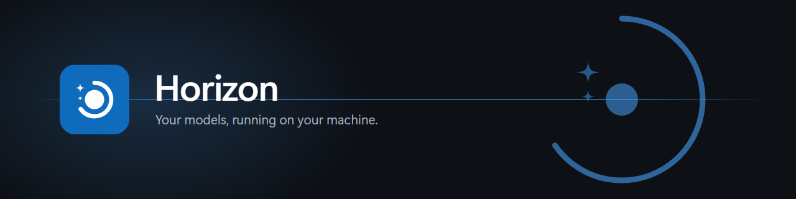



# Horizon

A private AI workspace for local chat with **Ollama**. Chats, saved prompts, memory and a document library — with Horizon's agent runtime coordinating local inference and permitted tools. Optional agent tools can access the network or run trusted local programs; those capabilities are off until enabled.

**Runtime status:** this checkout contains source-only Ollama plumbing. The Ollama-only runtime has **not** been validated here: no dependency installation, build, tests, inference, or browser run was performed. Use an isolated approved environment for acceptance before relying on it.

Chat and model requests stay on this machine; there is no account, subscription, or cloud inference service. Optional Agents can be configured to use public HTTPS pages or trusted command and MCP executables, which may have external effects. Keep Agents disabled for offline use, and read the access and storage notes below before enabling them.

## Who this is for

Not only developers. Horizon exists for anyone who wants an assistant that is *theirs*:

- A student or researcher working with drafts they would rather not upload
- A consultant, lawyer or clinician handling material that must not leave the building
- Someone on a boat, a plane, a field site, or any connection they cannot rely on
- Anyone who wants to experiment with a language model without an account, a subscription, a token budget, or a quota

The goal is to have somewhere to keep your chats, prompts, documents and notes, with a model that answers from your own hardware. Ollama provides inference; Horizon owns the LangGraph harness, controls the tools, and keeps the Human at its web UI in authority.

## Is this the right tool for you?

Horizon is built around **Ollama as its sole inference provider**. It uses Ollama's native loopback service and manages the Horizon-selected model; Ollama remains an independently owned service.

If you want a general-purpose front end that speaks to many providers — OpenAI, Anthropic, Ollama and others behind one interface — then [Open WebUI](https://github.com/open-webui/open-webui) or [AnythingLLM](https://github.com/Mintplex-Labs/anything-llm) will serve you better. Both are mature, well supported, and have far more features than this does.

Choose Horizon if you want the opposite trade: a Horizon-owned agent harness over one local inference runtime, with no Docker, no Electron, and no account. Node.js and Ollama are required.

## What you actually need

- Windows 10 or Windows 11
- PowerShell 5.1 or later (already included with Windows)
- Node.js 20 or later (use a supported LTS, such as 22 or 24; LangChain Core now requires at least 20)
- Roughly 10 GB of free disk space for the model and its supporting files
- Internet access for one-time setup, and optionally for link reading or Agents/browser tools you choose to use
- A local Ollama installation, in addition to Node.js.

## Getting started

The first launch is a double-click; preparing the model once requires running
the setup script in PowerShell.

### A. The simple way — download the ZIP

**1. Install Ollama and Node.js**

Open **PowerShell** from the Start menu (just type `powershell`), paste these two lines in, and press Enter after each. This is the only time you need it.

```powershell
winget install OpenJS.NodeJS.LTS
```

Install Ollama from [ollama.com/download](https://ollama.com/download). If `winget` is not recognised, install Node.js from [nodejs.org](https://nodejs.org) (choose the **LTS** version).

**2. Download Horizon**

On the [project page](https://github.com/itstejaswi/horizon), click the green **Code** button, then **Download ZIP**.

**3. Unblock the ZIP before extracting**

Windows marks files that come from the internet. Clearing the mark on the ZIP is one click, and saves you clearing it on every file afterwards.

- Right-click the downloaded `horizon-main.zip`
- Choose **Properties**
- At the bottom of the **General** tab, tick **Unblock**
- Click **OK**

If you do not see an Unblock box, there is nothing to clear — carry on.

**4. Extract it**

Right-click the ZIP, choose **Extract All…**, and put it somewhere that belongs to you, such as:

```text
C:\Users\<your name>\Documents\horizon
```

Avoid `C:\Program Files` — Windows restricts writing there, and Horizon keeps its settings beside itself.

**5. Double-click `Start Horizon.bat`**

A small black window opens — that is the server, and it stays open while Horizon runs. Your browser opens at:

```text
http://127.0.0.1:3000
```

The configured default model is `qwen3:1.7b`. Before your first chat, open
PowerShell in the extracted folder and run `.\scripts\Setup-Horizon.ps1` once;
it checks prerequisites and downloads the model if needed. Model downloads
require internet access. Once the model is present, local inference does not
require network access.

> ⚠️ **Do not close the black window to quit.** That window *is* the Horizon server. Use the **power button** at the bottom of the left rail or `Ctrl+C` for a graceful shutdown. Horizon unloads the model it owns; it does not stop the separately owned Ollama service.

> If Windows shows **"Windows protected your PC"**, click **More info** then **Run anyway**. That warning appears for any file from the internet that is not commercially signed. Ticking Unblock in step 3 usually prevents it.

### B. If you have Git

Cloning avoids the unblock step entirely, because files created by Git are not tagged as coming from the internet.

```powershell
winget install OpenJS.NodeJS.LTS
git clone https://github.com/itstejaswi/horizon
cd horizon
.\"Start Horizon.bat"
```

`Start Horizon.bat` manages dependency installation on first run for both ZIP downloads and Git clones. Running `npm install` by hand is optional.

### Read replies aloud

Assistant replies have a **Read aloud** button. **Settings → Behaviour → Read aloud** lets you select a local voice and opt in to automatic reading; automatic reading starts off. Playback stops when you submit another prompt, start a new conversation, hide the tab or close it.

This is independent Windows/browser speech synthesis. Only voices the browser explicitly identifies as local (`localService: true`) are used. If none are available, Horizon explains why rather than using a cloud or unverified default voice. Voice availability depends on the browser and installed Windows voices. Text is split into bounded chunks; over-limit replies fail explicitly rather than being silently cut off. Horizon does not record microphone audio or provide dictation.

### Already extracted without unblocking?

Clear the tag on everything at once:

```powershell
cd path\to\horizon
Get-ChildItem -Recurse | Unblock-File
```

### If you prefer PowerShell

```powershell
.\scripts\Start-Horizon.ps1
```

Use `Setup-Horizon.ps1` once to check prerequisites and prepare the configured Ollama model. The launcher can start Ollama when configured to do so and starts Horizon.

Ollama is a separately owned service. Horizon's Stop action unloads the Horizon-selected model, but deliberately leaves Ollama running.

### Closing it properly

Use the **power button** at the bottom of the left rail, or press `Ctrl+C` in the launcher window.

Closing the browser tab alone does not stop the Horizon server. Graceful shutdown unloads the Horizon-selected Ollama model; it does not stop Ollama or unload models owned by another Ollama client.

## The interface

A left rail holds everything, in the way you would expect from a modern chat app.

| Section | What it does |
|---|---|
| **Chats** | Every conversation, saved. Rename, delete, or clear the lot. |
| **Prompts** | Reusable openings. Pick one and it lands in the message box ready to finish. |
| **Memory** | Facts you want remembered across every chat, added to the model's instructions each time. Toggle it off whenever you like. |
| **Library** | Replies you chose to keep, via **Save** under any answer. |
| **Agents** | Configure local agent runs, tool permissions, workflows and schedules. |
| **Connection** | The health of the Horizon, Ollama and model hops, plus the air-gap indicator. |
| **Traffic** | What was sent and received, at a recording level you choose. |
| **Settings** | Instructions, creativity, storage usage, and a single button to erase everything. |

The model picker sits in the top bar. It lists models available to Horizon through Ollama, with sizes when reported; choosing one switches live, with no restart, keeping your conversation.

Light, dark, and match-Windows themes are in the top right. Your choice is remembered.

### Where your data lives

Chats, prompts, memory and library entries are stored in **this browser's local storage on this machine**. They are never uploaded, and the Horizon server never sees them — it only receives the messages you actually send. Settings shows how much space they occupy, and **Erase all data** removes every trace. Agents are separate: their definitions, settings, permissions, prompts, run history and tool results are stored by the local server in its runtime data file (currently `.runtime/agent-data.json`), not in browser storage. Treat that file as sensitive and do not commit or share it.

The browser-only **Erase all data** control deletes browser-stored chats and related data; it does not erase server-side agent data. **Agents → Settings → Erase agent data** is a separate, destructive action that cancels work, disables execution, and removes agent definitions, permissions, settings and run history. Neither control removes files an agent created or reverses external effects.

### Agents and tool access

**Runtime ownership:** Horizon's Node.js application owns orchestration, the LangGraph harness, run lifecycle, tool policy and human approvals. Ollama supplies local inference only. No external orchestrator or backend is used. The supplied OpenClaw archive is permitted only as source-text reference; it is not installed, launched or a runtime dependency.

Live activity has distinct local animations for thinking, writing replies, reading/searching files, writing files, browser actions, commands and MCP calls. Tool states come from actual run events, not guesses about the prompt. Approval waits and finished/stopped/error states are still; reduced-motion preferences disable animations throughout these indicators. No GIF downloads, external animation services or additional dependencies are required.

**Ordinary prompts can use tools too.** Open **Agents → Settings**, enable execution and the required feature flags, grant folders/configure trusted executables, and choose the tools under **Tools in the normal conversation**. Then just ask in the usual message box; no saved agent or separate run screen is required. The composer shows **Tools available** when this is enabled, or **Tools off** otherwise.

Conversation activity starts collapsed behind a chevron, preserving your expansion choice. Exact approval previews stay visible outside the collapsed details. Click **Tools available** (or **Tools off**) to review this conversation's approval preferences: allow reads within existing folder grants and public browsing/search, or ask each time. The choices are saved with that browser-stored conversation and never expand tool grants, roots or network access. The default allows granted file reads and public `browser_open`, `browser_snapshot`, `browser_search` and `browser_close` without repeated confirmation, as requested. Writes, commands, MCP calls, arbitrary clicks and fills still need one-use conversation approval; a model claiming a click is harmless changes nothing. Search uses only a fixed DuckDuckGo HTTPS GET URL, never arbitrary form submission. Submit/send, delete, reject and ambiguous clicks require confirmation. Existing grants do not automatically gain the newly added search tool: enable it explicitly in Agents settings.

**Stop** cancels the conversation run; page closure also requests cancellation. Completed tool actions are not undone. Runs and results remain recorded in **Agents → Activity**, even after erasing browser chats. Settings changes cancel pending work.

When a conversation needs you to interact with the visible browser or provide
information before it can continue, Horizon records a **Waiting for you**
handoff and returns control to the composer—there is no hidden background wait.
For example, ask Horizon to open its viewport (no URL is needed), make your
changes in the isolated Edge window, then send “check now” in the same
conversation. After confirming the blank viewport is open, Horizon returns a
ready message without another model call. Your next message starts a fresh run
bound to the same conversation and browser, and Horizon reads the currently
selected page before answering. The handoff is linked to that follow-up run in
local history and carries a checkpoint of the original request and recent
completed tool results capped at 8,000 characters. The latest user message
remains controlling, permissions are revalidated, and completed side effects
are not replayed automatically.
Multi-step fixed workflows retain their results up to a 24,000-character cap.
Restarting Horizon still interrupts unfinished runs and does not replay their
actions or restore an ephemeral browser.

Native conversations use the existing native function-call loop directly: the same model decision returns ordinary assistant text or a tool call. There is no extra JSON intent classifier, greeting keyword filter or mandatory plan, even when saved-agent planning is enabled. **Migration:** ordinary conversation protocol is normalized to native when loading/saving settings; saved agents retain their individual structured/native protocols and planning option. Persisted runs, history, folder grants and allowed-tool lists are preserved. No model or dependency is installed. Models still differ in tool reliability; errors are shown rather than fabricated as success. Tool-enabled conversations use temperature zero and a bounded 2,048-token response budget rather than the creativity slider. History is capped at 64 messages / 48,000 serialized JSON characters, with 20,000 characters per message; complete tool context is capped at 64,000 characters and the model's token limit still applies.

Interactive browser tools open a **visible, dedicated isolated Microsoft Edge window per conversation** (requires installed Edge), retained across turns until `browser_close`, manual window closure, agent-data erasure or server shutdown. They follow manual navigation and the last selected tab, not a personal signed-in browser or general desktop. Separate conversations cannot read each other's tabs. `browser_snapshot` takes exactly `{}` and reads the selected page's URL, title and bounded text, including after manual navigation; it does not take screenshots. Stop interrupts the in-flight browser action by closing its tab, leaving other conversation tabs intact; close/reopen starts a fresh browser. Saved/scheduled tasks remain headless Chromium, isolated per run, and close on completion. Public HTTPS, private-address/DNS checks, the IP-validating proxy, blocked service workers/WebSockets and disabled downloads remain enforced. Generic clicks/fills require approval even for saved agents that previously preapproved them.

Visible browser pages resize with the Edge window rather than using a fixed emulated viewport. Saved/headless tasks retain the default fixed viewport.

Sites may challenge these fresh automated sessions. Using Edge does not guarantee CAPTCHA-free Google searches; Horizon neither bypasses challenges nor copies personal browser profiles. The opt-in `node tools/diagnose-browser-network.js` compares two fresh Edge sessions (direct and Horizon-guarded), with one Google search each, records failures/redirects and verifies private CONNECT rejection. It does not inspect existing personal/Scout sessions or interact with a challenge. Reports stay under `.runtime`.

#### Experimental native planning and outcome checks

**Agents → Settings → Plan and verify native tasks** is off by default. It applies only to model-driven saved agents on the native engine, not ordinary conversations or fixed workflows. Saved agents retain either structured or native protocol; planning has its own explicit JSON contract.

**Experimental and model-dependent:** JSON planning is not reliable on every local model. Some cached small models may misformat otherwise valid tasks, supply invalid write arguments, mix check parameters into tool arguments, or ask unnecessary clarification. The engine stops and reports problems rather than relaxing validation or verification checks. Successful execution with one compatible model does not establish general model reliability. Fixed workflows remain the predictable option when you already know the required tool arguments.

Planned mode always requests a JSON plan, independent of the agent's tool-call protocol. A single enclosing JSON code fence is accepted only when it wraps the whole response; normalization records a `format` event and does not relax validation. Prose around a fence or malformed data is still rejected. The model first proposes up to the run's `maxSteps` concrete steps, each with a `title`, `tool`, `args` and optional `check`. These are straight-line, known-argument plans, not adaptive branching or full replanning. Arguments may reference an earlier step's structured result with `{"$result":{"step":0,"pointer":"/sha256"}}` (zero-based step index); a check's arguments may also reference its own action's result. The engine resolves references at execution time. It validates the entire plan before executing any step; it may ask the model to repair an initially malformed plan once, before any tool is called. There is no inference retry or replanning after execution begins. **A plan is not permission or approval.** Existing tool grants, roots, feature flags and approval requirements still apply.

- A planned `file_write` gets an automatic fresh readback with SHA-256 comparison through permitted `file_read`. If that read is not allowed, the write plan is rejected before execution.
- A step can specify a check shaped like `{"tool":"file_read","args":{"path":"C:\\Users\\you\\Documents\\notes.txt"},"pointer":"/content","contains":"expected text"}`. Checks may use only `file_read`, `file_list` or `file_search`, with a JSON pointer and either `equals` (a JSON primitive) or `contains` (a nonempty string). The predicate is evaluated deterministically against a fresh real read result, not a model's assertion.
- Every actual tool call, including checks, write readbacks and retries, counts against `maxSteps`; a plan must leave room for its required checks and readbacks. Read-only calls may retry once only for explicit transient error codes, using spare capacity after reserving the remaining planned calls. Uncertain side effects are never retried; there is no side-effect replay or automatic resume.

Run cards and inline conversation activity show the saved plan, individual step progress, outcome-check status and any recorded evidence. **Tool succeeded; no outcome check configured** means execution succeeded, not that the requested outcome was proven. **Configured outcome check passed** means only the specified predicate or write readback passed. Overall verification can be passed, partial or not configured; inspect step failures and the run status as well. These bounded checks are not full autonomous semantic verification of user intent. Saved fixed workflows remain literal sequences, not reusable parameterized skills. Small models can still produce poor plans or inadequate checks; review results before relying on them.

Agents are off until enabled. The master switch and individual file, command, browser and MCP flags are separate controls; enabling a feature does not grant every tool. New agents start with read-only file tools. Review the agent's allowed tools and explicitly granted unattended tools before saving. Without fixed workflow steps, actions are model-driven; with steps, the saved sequence runs deterministically and does not ask the model to choose the next action. Steps are JSON objects of the form `{"tool":"file_list","args":{"path":"C:\\Users\\you\\Documents"}}`; file tool paths must be absolute paths under an approved root. The editor provides more argument examples. Each step's tool must also be on the agent's allowed-tools list, and workflow length cannot exceed the configured maximum (up to 32). A scheduled agent must have a default prompt or at least one fixed step. Model support varies, so neither protocol guarantees reliable actions.

**Approval policy migration:** writes, commands, MCP calls and arbitrary browser clicks/fills now require exact human approval even for saved or scheduled agents with legacy unattended grants. Persisted grants/history are preserved, but unattended grants apply only to public read-only browser operations and MCP tool listings; granted file reads remain automatic. Scheduled side effects wait for approval and can time out rather than silently bypassing this policy.

File tools can be limited to approved absolute roots. Command and MCP working directories (`cwd`) must also be existing directories under an approved root, but this starting-directory check does **not** sandbox commands, MCP servers or browser actions. Commands and MCP servers run configured trusted executables and can have unrestricted effects outside those roots. The browser uses a fresh isolated context, accesses public HTTPS only, is online, and cannot use personal browser sign-ins. It is not the browser profile Horizon is open in.

Agent schedules are interval-based and persistent. They run only while the server and computer are awake; missed occurrences (including one over 30 seconds late after wake) and overlapping runs are skipped, and interrupted runs are not resumed or replayed. Re-enabling execution resets upcoming times instead of replaying missed schedules. The Agents panel shows server-computed upcoming run times and asks for approval when a run needs it. Run history is bounded to 100 runs / 16 MB, with at most 150 events per run and tool results capped at 12,000 characters. Agent context is limited to 64,000 serialized JSON characters, not tokens; the model's own token context limit also applies. Run the **Stop all** control to cancel active and queued runs and disable agent execution.

Agents continue to use local model inference; enabling network-capable tools does not send inference to a cloud model. However, browser, command and MCP tools may use the network, so a tool-enabled session is **not an air-gap guarantee**. The Connection/privacy status distinguishes local inference from network-capable tools and reports whether external tools are enabled or have been used. Agent history records runs and tool events/results (bounded to 100 runs / 16 MB, with up to 150 events per run); it is **not a network audit log** and does not record every network request made by a command or MCP subprocess. There are no cloud API keys or cloud token charges for Agents; local model usage is still limited by the model's context window.

The browser dependency is provisioned during one-time Horizon setup. MCP servers are external executables: install and maintain each trusted MCP server yourself before configuring it.

**Local acceptance:** `npm test`, `npm run check` and `npm run build` exercise the existing offline regression suite and build. `npm run test:conversation` is separately opt-in: it requires the already-installed `qwen3:1.7b` at `http://127.0.0.1:11434`, Microsoft Edge for conversation browsing, and existing Chromium for the UI test driver. It launches visible isolated browsers and a separate Horizon server, uses synthetic files only, and performs actual local inference, public example-page browsing/search, approvals, cancellation and lifecycle checks. `node tools/validate-browser-followup.js` separately exercises the exact page-reading follow-ups with mistaken refusals in history, manually selected tabs, actual Google response/challenge reporting, unique synthetic page content and desktop/390px scroll pinning. Its UI response is synthetic; its page-reading model/tool calls are actual local Qwen. It installs/downloads nothing and does not change the normal server's grants or history. Results and screenshots stay under `.runtime`; this is representative acceptance, not a general model-reliability guarantee.

## Everyday use

`Start Horizon.bat` is the one entry point. Everything else is a shortcut to it.

| What you want | What to do |
| --- | --- |
| Start it | Double-click **`Start Horizon.bat`** |
| Start it every time you sign in | Settings → **This machine** → *Start when I sign in* |
| A desktop icon | Settings → **This machine** → *Desktop shortcut* |
| Its own window, no browser tabs | Browser menu → Apps → **Install Horizon** |
| Open it when it is already running | Click the shortcut again — it opens the page rather than starting a second copy |
| Stop it | Power button in the left rail, or `Ctrl+C` in the launcher window |

Both shortcut options write a normal `.lnk` into your own Start Menu and Desktop folders. They need no administrator rights, trigger no UAC prompt, and unticking the box deletes the file again. Nothing is written to the registry.

### What "start when I sign in" actually does

It launches `Start Horizon.bat` **minimised**. You will see a *Horizon* entry in the taskbar — that console window is the server, and it is deliberately visible rather than hidden, because it is also the honest way to stop it.

Horizon itself is small: around **55 MB** of memory sitting idle. What costs real memory is a *model*, and no model is loaded until you ask for one. The **Service** tab shows both numbers side by side.

### Launching it twice

Horizon only ever runs one server. If you click the shortcut while it is already running, the second launch checks the first is genuinely alive, opens that page in your browser, and exits — it will not start a competing server or take over the first one's port.

## Working with files and links

**Attach a text file** with the **+** button in the composer, or drag one onto it. The file is read in your browser and folded into your message — nothing is uploaded anywhere. If a file is longer than a message can carry, the chip says so plainly rather than silently sending a fraction of it.

**Links are a different matter, and worth understanding.**

A model cannot open a link. Asked to summarise one, it reads the words in the address and writes plausible prose around them. In a historical check with a deliberately invented news URL, phi-4 produced a confident, detailed summary of an event that had never happened — including policy analysis. That example predates this Ollama-only update and is not runtime validation for it.

So when you paste a link, Horizon says so:

- **By default**, an amber note: *the model can't open links, details may be invented.*
- **If you switch on link reading** in Settings, Horizon fetches the page itself and hands the model the real text. The note turns blue and says what will happen.

Link reading is **off by default**, because it is the one part of Horizon that leaves your computer. When it is on:

- The request goes to that site, which sees your address, exactly as a browser visit would
- **The page content stays here.** It goes to your local model and nowhere else
- Private and local addresses are always blocked, so a pasted link cannot reach your router, a service on `localhost`, or a cloud metadata endpoint
- Pages that need a sign-in, and those built entirely by JavaScript, will not read — and say so rather than pretending

A message shows what came with it: a chip for each file and each page, struck through if a page could not be read.

## Keeping your data

Your chats, prompts, memory and saved replies live in your **browser's own storage**. That is private — nothing is written to disk — but it is also fragile: clearing your browsing data wipes it, and another browser cannot see it.

Settings → **Your data** → *Keep a copy on this computer* writes everything to a plain JSON file, including your instructions and preferences. If Horizon later finds an empty browser and a saved copy, it offers to restore it.

This is off by default, and the file is readable without Horizon.

## About and privacy

The **?** button opens a page that separates three things people usually blur together:

- **Horizon's chat and model path** collects no telemetry and talks to the configured local Ollama endpoint. The request log lets you inspect that traffic.
- **Agents** are an optional exception to the local-only network path: the browser tool can visit public HTTPS sites, and configured commands or MCP servers may have unrestricted external effects. Those activities are not represented in the chat request log or air-gap indicator.
- **Ollama** is a separately managed application. Check its own documentation for its model downloads and network behavior; Horizon's local request log does not audit Ollama itself.
- **The model** has no network access of its own.

## Building on Horizon

Start with [Vision](Vision/README.md): the public contributor handoff covering
the Ollama-only runtime contract, Horizon-owned orchestration boundaries and
isolated acceptance criteria. OpenClaw is not a runtime dependency; only
selected source patterns inform Horizon's own code.

## Running the tests

```powershell
npm test
```

The documented regression commands are for future acceptance in an isolated
environment. The Ollama-only source update has not been tested or built here;
see [Vision/ACCEPTANCE.md](Vision/ACCEPTANCE.md) for the required gates.

### Horizon Native tool execution

Horizon Native uses a real, sequential **LangGraph.js StateGraph** to coordinate
model decisions and permitted tools without an OpenClaw process. Choose **Native tool calls** for a model that
supports function calling, or **Structured actions** for the JSON action
protocol. The provider selection and the tool protocol are separate settings;
the engine does not silently switch protocols or grant tools.

Model actions are checked against the available tool schemas before execution.
One shared format/schema/grounding/truncation correction is allowed per run,
without replaying a tool. Each inference is limited to 2,048 output tokens;
reasoning is discouraged (`/no_think` for compatible Qwen models), not given
unlimited tokens. A second truncated or invalid decision fails explicitly.
Permission failures, execution failures and budget exhaustion stop explicitly.
Run activity and chat errors identify the failure stage. Exact-call approvals,
cancellation and configured task limits still apply.

The graph runs prepare → decide → validate → act → observe → verify → answer,
with bounded transitions back to decide. It uses the Ollama HTTP adapter and
serial inference queue, not another model, router, sidecar or hosted service.
Pins: `@langchain/langgraph` **1.5.2**, `@langchain/core`
**1.2.20**, and its `zod` peer **4.6.6**. Both native and structured dynamic
runs use the graph. Fixed saved workflows and experimental **Plan and verify
native tasks** keep their existing deterministic execution/readback paths.

**Browser grounding is deliberately conservative.** Opening, clicking or filling
returns metadata, not page evidence: the graph obtains a guarded snapshot
afterward even if the model neglects to ask. An already-open conversation
browser is freshly read before the next decision, including manual navigation
and selected-tab changes. A final snapshot checks the selected page again.
All these reads consume the same tool budget and respect your read approvals;
navigation without the snapshot grant cannot produce a page answer. Opening
just to show a page also collects bounded text; it does not click consent
buttons or bypass challenges.

While a page is observed, answers are **extractive**, not free-form model
summaries: the model selects an exact relevant excerpt (at most 2,000
characters), checked against the freshly read text, and Horizon renders it
with title/URL and an explicit provenance label. A fabricated value or false
browser refusal fails this check, with at most one correction. An empty
answer reports that the requested information could not be established.
Matching text does **not** prove site truth, freshness of a publisher's data,
relevance, or completeness: a model can still select an unrelated sidebar.
Not-found pages and challenges are not the requested facts. Close the retained
browser with `browser_close` when finished; otherwise subsequent turns continue
to observe it and use this conservative page-answer mode.

Snapshot context contains at most 8,000 page-text characters; omitted content
is explicitly marked truncated. Recent model history is limited to 12 messages /
16,000 serialized characters, within an overall 64,000-character ceiling.
These are character limits, not promises about a model's token window.
General non-browser replies remain unverified model text; other successful
tool execution is not an independent outcome check.

Graph state lives only for the current run: there is no remote or persistent
checkpointer and no duplicated long-lived model context. Existing run/history,
events, approval UI, polling/SSE, cancellation and timeout persistence remain
owned by AgentService. Restart marks unfinished runs interrupted; it does not
resume graph nodes or replay effects. Restart also loses isolated browser
contexts. Restart Horizon after installing this change; an already-running
backend does not hot-reload it.

No LangSmith callbacks or remote tracing are configured. To protect private
prompts, graph execution fails **before supplying inputs** if inherited
`LANGSMITH_TRACING`, `LANGCHAIN_TRACING_V2`, `LANGCHAIN_TRACING` or
`LANGCHAIN_VERBOSE` is enabled. Horizon does not silently change your global
environment. Unset those flags (or set them to `false`) in Horizon's launch
environment. Transitive SDK packages do not imply hosted inference or a remote
graph service is used.

In an isolated acceptance environment, `node tools\validate-langgraph.js` is
intended to run actual `qwen3:1.7b`/Ollama and isolated visible Edge acceptance
on a separate ephemeral server, using
controlled synthetic HTTPS fixtures (not live financial data or Google
searches). It checks navigation→observation, manual tab changes, old false
refusals and missing data, saving actual decisions and run evidence under
`.runtime\langgraph-*`. It never restarts your regular backend, installs a
model, or accesses personal browser profiles.

### Isolated runtime acceptance

Use the isolated gates in [Vision/ACCEPTANCE.md](Vision/ACCEPTANCE.md) after
source plumbing is complete. They require Node.js 20+, Ollama, the selected
model and controlled fixtures. No installation, test, build, inference or
browser validation was performed for this update.

## The five scripts

| Script | What it does | When to run it |
|---|---|---|
| `Setup-Horizon.ps1` | Checks Node.js and Ollama, then downloads the configured model if needed | Once per machine |
| `Start-Horizon.ps1` | Starts Horizon, may start Ollama when configured, and opens the chat page | Every time you want to chat |
| `Optimize-Horizon.ps1` | Measures available models and can select a faster one | Once, or when replies feel slow |
| `Test-Horizon.ps1` | Checks Horizon, Ollama and model availability | When something seems wrong |
| `Stop-Horizon.ps1` | Stops Horizon and unloads its selected model; leaves Ollama running | When you are done |

## Making it fast

Run this to measure your own machine rather than guess:

```powershell
.\scripts\Optimize-Horizon.ps1 -Apply
```

It inspects your hardware and available Ollama models, measures candidates when supported, and can write the selected model to `config.local.json`. Add `-IncludeCandidates` only if you intend to download additional models. Optimizer behavior in this source-only update has not been runtime-validated.

### What actually affects speed

Some things are fixed by your hardware, and some are not.

| Lever | Effect | Already handled |
|---|---|---|
| **Streaming replies** | Text appears as it is generated instead of all at once at the end. On a slow machine this is the difference between waiting 20 seconds and reading after 1. | Yes, on by default |
| **Model size** | The single biggest real lever. A 1.5B model is several times faster than a 14B one. | `Optimize-Horizon.ps1` finds the fastest |
| **Reasoning models** | Models like `qwen3` "think out loud" before answering, spending hundreds of tokens first. Measured here: **1067 tokens to answer "say hello in five words"**. | Folded into a collapsible section; the optimiser prefers non-reasoning models |
| **Warm-up** | The first completion after loading is much slower than the rest. | Done at startup, before you type |
| **Keeping the model loaded** | If Ollama unloads the model, the next message pays the load cost again. | `ollama.keepAlive` controls the requested retention period |
| **Conversation length** | Every message re-sends the history for reprocessing. Long chats get slower. | Capped by `chat.historyLimit`; the app tells you when older messages are dropped |
| **Raw tokens per second** | Fixed by your GPU, CPU and memory bandwidth. Nothing in software changes this. | Not fixable, but measured and reported |

### Hardware and model performance

Performance depends on the selected Ollama model, its backend and your
hardware. No optimizer benchmark is claimed for this source-only runtime
update.

## How the pieces fit together

```text
Your browser
  -> Node.js web server        (loopback only, port chosen at run time)
  -> Ollama native API         (loopback only, normally 127.0.0.1:11434)
  -> the model, on your hardware
```

Your browser never talks to Ollama directly. It only talks to the small Node.js server in this folder, which passes inference requests locally. Horizon owns the LangGraph harness and remains responsible for tool access, approvals and run state; the Human at the web UI is the authority.

## Configuration

Default values live in **`config.json`**. Use the ignored `config.local.json`
overlay or supported environment variables for machine-specific overrides.

| Setting | Default | Meaning |
|---|---|---|
| `web.port` | `3000` | The address you open. If it is busy, Horizon moves to the next free port and says so. Set `0` to always let the system choose. |
| `web.portSearchLimit` | `20` | If a pinned port is busy, how many ports upward to try before giving up. |
| `web.openBrowser` | `true` | Open the browser automatically on start. |
| `provider` | `ollama` | The sole inference provider. |
| `model.alias` | `qwen3:1.7b` | The selected Ollama model. |
| `inference.requestTimeoutMs` | `120000` | Maximum time for an inference request. |
| `inference.statusTimeoutMs` | `5000` | Maximum time for an Ollama status check. |
| `inference.statusCacheMs` | `3000` | How long to reuse an Ollama status result. |
| `inference.warmUpOnStart` | `true` | Send a bounded warm-up request at startup. |
| `inference.warmUpTimeoutMs` | `300000` | Maximum time for startup warm-up. |
| `ollama.baseUrl` | `null` | Ollama URL; default is native loopback `http://127.0.0.1:11434`. |
| `ollama.keepAlive` | `30m` | Requested Ollama model retention period. |
| `ollama.binary` | `null` | Optional Ollama executable path; otherwise resolve from `PATH`. |
| `ollama.autoStart` | `true` | Whether Horizon's launcher may start Ollama when needed. |
| `chat.systemPrompt` | *(see file)* | The instruction that shapes the model's personality. |
| `chat.temperature` | `0.7` | Creativity. Lower is focused, higher is varied. |
| `chat.historyLimit` | `30` | How many past messages are sent back to the model. |
| `chat.stream` | `true` | Show words as they are produced. Turning this off makes replies feel much slower. |
| `backup.enabled` | `false` | Keep a copy of your chats, prompts, memory and preferences on disk. |
| `backup.directory` | *(your home folder)* | Where that copy is written. |
| `reader.enabled` | `false` | Let Horizon fetch a page you paste and give the text to the model. |
| `reader.maxChars` | `12000` | How much of a page to pass along. |

Both `backup` and `reader` are off by default and are normally switched on from **Settings** rather than edited here. The choice is written to `config.local.json`, which is not tracked by git.

### Memory, and shutting down cleanly

A model may stay resident in Ollama after a browser tab or Horizon closes. Use the Horizon power button, `Ctrl+C`, or `Stop-Horizon.ps1` for graceful Horizon shutdown and to unload the model Horizon selected.

```text
Shutdown request received. Shutting down...
  Releasing qwen3:1.7b from memory... done
  Goodbye.
```

Horizon deliberately does not stop Ollama, which may be shared with other applications. Stop Ollama from its own application only when you intend to stop that independently managed service.

### Ports are never hardcoded

The web server can choose a free port at runtime or use a configured port. Ollama normally uses its native loopback address, `http://127.0.0.1:11434`; set `ollama.baseUrl` or `HORIZON_OLLAMA_URL` only to an approved loopback Ollama endpoint.

The chosen values are written to `.runtime/horizon.json` while the app runs, so `Stop` and `Test` read them from there instead of guessing.

### Overriding without editing files

Settings resolve in this order, with earlier entries winning:

```text
command-line argument  >  environment variable  >  config.local.json  >  config.json  >  built-in default
```

```powershell
# Pin a port for one run only
.\scripts\Start-Horizon.ps1 -WebPort 3000

# Try a different Ollama model
.\scripts\Start-Horizon.ps1 -ModelAlias qwen2.5:0.5b

# Start without opening a browser
.\scripts\Start-Horizon.ps1 -NoBrowser
```

Create `config.local.json` for personal settings you do not want committed to source control. It is ignored by git and overlays `config.json`.

## The control panel

Click the panel icon in the top right. It has three tabs, and its purpose is to let you *verify* the privacy claim rather than take it on trust.

### Connection

Shows the health of the local path — browser → Horizon web server → Ollama → selected model — each with its own state, address, and response time. When something breaks, you can see exactly which link failed instead of guessing.

Above it sits the **air-gap indicator**. It detects connectivity **passively** from the browser's own signal; Horizon never makes an outbound request just to test for internet. This indicator describes the browser's connectivity, not whether an agent tool or configured program is attempting network access.

The same badge doubles as an **activity light** for Horizon's link-reading feature. While a page you asked it to read is being fetched, the badge turns amber, pulses, and names the host: *Reading example.com*. Agent browser requests, commands and MCP network activity do not use that indicator.

To be precise about what is happening: the **model** has no network access at all. Horizon fetches the page and hands the text over. The badge reports Horizon reaching out, not the model.

Beneath it is a scope note: Horizon collects no telemetry and has no analytics.
Ollama is a separately managed process; consult its own documentation for its
network and privacy behavior.

### Traffic

Every request and response, with a **recording level** you control:

| Level | Keeps | Use when |
|---|---|---|
| **Off** | Nothing | Working with very large inputs and you want the page as light as possible |
| **Summary** | Sizes and timings only | The sensible default — safe with documents of any size |
| **Full** | Complete bodies, truncated at 4 KB each | You want to read exactly what was sent |

Only the last 20 exchanges are kept, and each body is capped, so the page cannot accumulate megabytes of text no matter how large your inputs are. This is the strongest answer to "how do I know nothing is being uploaded?" — you can read the entire exchange and see it only ever goes to `127.0.0.1`.

### Models

Models available to Horizon through Ollama, with sizes when reported. Switch between them with one click — no restart, and your conversation is kept. The model currently in use and any others still resident in memory are marked.

## Trying things out

Click the gear icon to experiment live:

- **Instructions for the model** — change its character. Try `You are a terse pirate.` and send a message.
- **Creativity** — drag to `0` and ask the same question twice; you should get near-identical answers. Drag to `1.8` and the replies get far more inventive.

Both apply to your next message. No restart needed.

The sun/moon icon cycles between following Windows, light, and dark.

While a reply is generating, the send button becomes a stop button. `Esc` also stops it. Anything already written is kept.

If the model thinks out loud before answering, that working is tucked into a **Working it out** section you can expand. The answer itself stays clean.

Under the message box you get real numbers for each reply: how many tokens, how fast, and how long until the first words appeared.

## Ollama runtime and model selection

Ollama is Horizon's only inference provider. Install Ollama separately from
[ollama.com/download](https://ollama.com/download); Horizon does not install or
replace its service. The default configuration selects `qwen3:1.7b`. Setup
prepares the configured model; use Ollama's own CLI to pull another model when
needed:

```powershell
ollama pull qwen3:1.7b
```

| Setting | Environment variable | Default |
|---|---|---|
| `provider` | — | `ollama` |
| `model.alias` | `HORIZON_MODEL_ID` | `qwen3:1.7b` |
| `ollama.baseUrl` | `HORIZON_OLLAMA_URL` | `http://127.0.0.1:11434` |
| `ollama.keepAlive` | — | `30m` |
| `ollama.binary` | — | Resolve `ollama` from `PATH` |
| `ollama.autoStart` | — | `true` |
| `inference.*` | — | Shared request/status timeouts, status cache and startup warm-up |

`HORIZON_MODEL_ID` replaces the former Foundry model environment variable.
`HORIZON_OLLAMA_URL` must refer to the native loopback Ollama service; Horizon's
web server and inference endpoint are distinct. Model size and tool-following
quality vary; the selected model does not make agent behavior reliable by
itself. Horizon-specific Ollama endpoints are under `/api/ollama/*`; the former
`/api/foundry*` surface is not part of this runtime.

Dictation and microphone recording are not provided. Independent local
Windows/browser read-aloud remains available when the browser exposes a
verified local voice. No OpenClaw runtime is installed or executed; only
selected source patterns inform Horizon's own harness.

## Using a different model

The code contains no model-specific inference provider. Pull another Ollama model and select it:

```powershell
ollama list
ollama pull qwen2.5:0.5b
.\scripts\Setup-Horizon.ps1 -ModelAlias qwen2.5:0.5b
.\scripts\Start-Horizon.ps1 -ModelAlias qwen2.5:0.5b
```

To make the change permanent, edit `model.alias` in `config.json`.

## Running with no internet

### What Horizon promises

With Agents disabled and link reading off, Horizon's chat/model requests go to the configured loopback Ollama endpoint, and the request log shows the local chat path. Agents can access public HTTPS pages; configured commands and MCP servers can also perform external network activity. That activity is not covered by the chat request log or air-gap indicator. Disable Agents and do not run externally connected tools when you need a genuinely offline session. Horizon collects **no telemetry** and has **no analytics**.

Ollama is a separately managed process. Horizon may start it when `ollama.autoStart` is enabled and unloads the model selected by Horizon at shutdown, but does not stop the Ollama service.

### Verifying it

1. While connected, run `Setup-Horizon.ps1` and let the download finish.
2. Confirm the model is available: `ollama list`
3. Run `Start-Horizon.ps1` and send a message to prove it works.
4. Disconnect the network, or apply your organisation's approved isolation.
5. Run `Start-Horizon.ps1` again. It should still answer.

Before disconnecting, disable agent execution, cancel active runs with **Stop all**, turn off link reading, and make sure no configured command or MCP process is relying on the network. The Connection tab reports the chat/model path; it does not monitor agent tools. When those agent paths are idle, the panel's **Fully offline** indicator and Traffic tab describe the local chat path only.

Being local does not exempt you from your organisation's data-handling rules. Do not enter customer, patient, confidential, or otherwise regulated information unless that use has been explicitly approved.

## Project layout

```text
config.json               every adjustable setting, in one place
package.json              project metadata; `npm start` runs the server
src/config.js             merges config file, environment, and CLI arguments
src/net.js                loopback checks and free-port selection
src/ollama.js              Ollama connectivity, model access and inference
src/runtime.js            records the live port, endpoint, model, and process ID
src/desktop.js            shortcuts, and starting at sign-in
src/backup.js             the optional copy of your data on disk
src/reader.js             fetching a pasted page, and blocking private addresses
src/server.js             the web server and local API
public/index.html         page structure and the inline icon set (generated)
public/app.css            Fluent 2 design tokens, light and dark
public/agents.js          optional agent controls and local API client
public/agents.css         Agents panel styling using Horizon theme tokens
public/chat-tools.js      conversational tool activity, approvals and cancellation
public/speech.js          optional verified-local browser voice playback
public/app.js             chat, streaming, drawers, model picker, settings
public/store.js           local storage for chats, prompts, memory and library
public/manifest.webmanifest  lets the page install as an app
public/brand/             the Horizon mark, icons and favicon
tools/index.template.html source for index.html; never edit the built file
tools/build-html.js       assembles the page and the bespoke symbols
tools/build-icons.js      extracts Fluent icons into an inline sheet
tools/build-icons-png.js  rasterises the mark for Windows and PWA icons
test/regression.js        the whole suite; `npm test`
scripts/Common-Horizon.ps1  shared PowerShell helpers
scripts/*.ps1             Setup, Start, Optimize, Test, Stop
```

`public/index.html` is **generated**. Edit `tools/index.template.html` and run `node tools/build-html.js`.

## Credits

An independent local assistant using Ollama for inference.

UI/UX connector designed by **Tejaswi**.

Icons are from [Fluent System Icons](https://github.com/microsoft/fluentui-system-icons) (MIT). See `NOTICE`.

## Interface notes

- Built on Microsoft's Fluent 2 design language: its colour ramps, type ramp, corner radii, elevation and motion curves.
- Light, dark, and follow-Windows themes.
- Icons are inline SVG symbols reused by reference, so there is no icon font or network request.
- Streaming text is painted on an animation frame rather than on every token, keeping scrolling smooth when tokens arrive in bursts.
- Auto-scroll pauses if you scroll up to re-read, and resumes when you return to the bottom.
- Model output is never parsed as HTML. Code fences become real elements; everything else is inserted as plain text.
- Honours `prefers-reduced-motion`.

## Design notes

- The web server binds only to a loopback address and refuses anything else.
- Horizon accepts only an approved loopback Ollama inference endpoint.
- Static files are served from `public/` only, with directory traversal blocked.
- The Content-Security-Policy allows no inline scripts or styles, and no external origins.
- Ollama requests use shared `inference.*` timeouts; `/api/ollama/*` provides the Ollama-specific service surface.
- Model names sent from the browser are validated against a strict pattern and passed as separate process arguments, never interpolated into a shell string.
- The air-gap indicator is passive; it never makes a network request.
- The air-gap indicator and request log cover the chat/model path, not network activity initiated by Agents, commands or MCP servers.
- Agent definitions and run history are stored server-side in local runtime data and may contain private prompts and tool results.
- The conversation lives in the browser tab's memory and is never written to disk.
- No analytics, telemetry, remote fonts or CDN assets. The base chat UI uses local assets; agent browser execution relies on a separately provisioned browser dependency.

> This Ollama-only runtime is source-plumbed but has not yet passed isolated runtime acceptance. Do not rely on it for production workloads until the required acceptance is complete.

## Licence

Copyright (C) 2026 Tejaswi C.

Released under the [GNU AGPL v3](LICENSE). You may use, study, modify and share
it freely. If you run a modified version and let others reach it over a network,
section 13 requires you to offer them your source as well — rehosting it
unchanged is welcome, rehosting it changed and silent is not. Running it on your
own machine for yourself, which is the point of Horizon, triggers nothing.

Fluent System Icons remain under their own MIT licence. See `NOTICE` and
`COPYRIGHT`.
