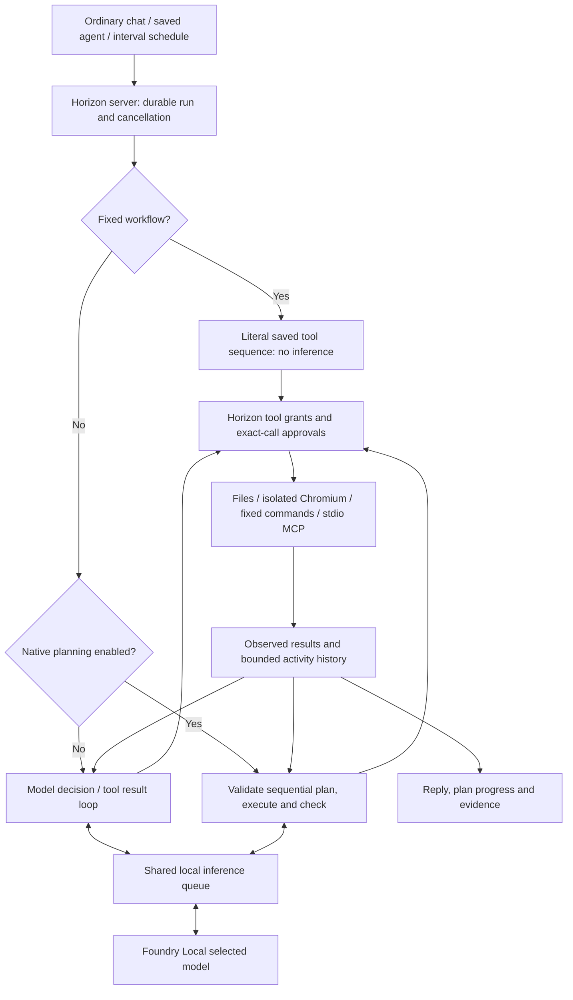
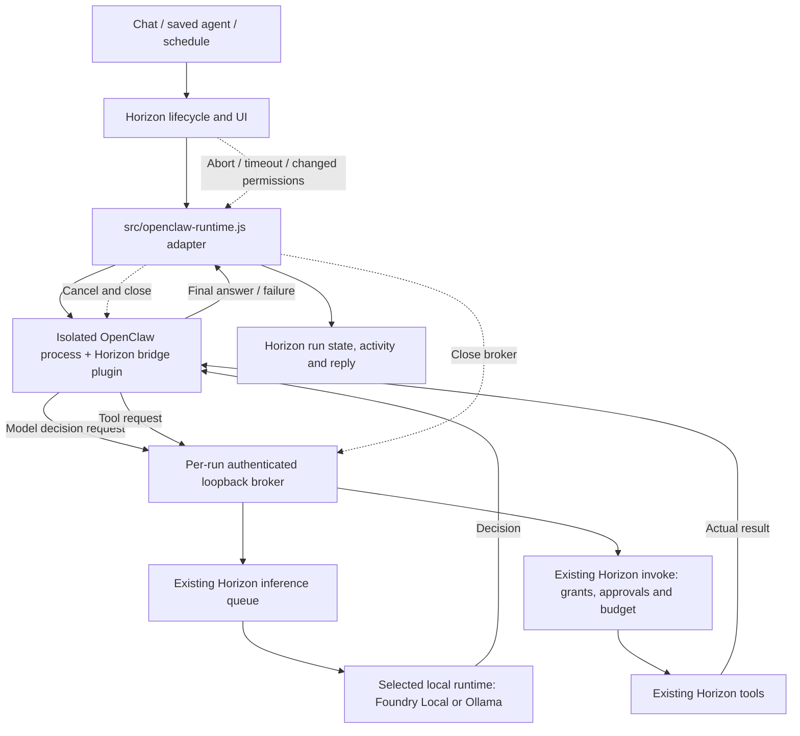

# Architecture and ownership

## Current supported path



The native decision loop can choose another action after each tool result.
Experimental planned mode instead validates a straight-line plan, resolves
references to earlier structured results, executes it and evaluates checks.
It does not branch or replan after execution begins.

Fixed workflows bypass both the model loop and backend selection. Changing the
backend must not convert those workflows into model-driven tasks.

## OpenClaw path: connected, experimental



Per run, the adapter creates a broker with only the run's granted tool
definitions, writes a throwaway `openclaw.json` into a fresh temporary state
folder and runs `openclaw agent --local --json --message-file …` with
`process.execPath`, no shell and a minimal environment. The config:

- declares one provider, `horizon`, pointing at the broker's `/v1` with
  `models.mode: "replace"` and no fallbacks; its `apiKey` is the literal
  `${HORIZON_BROKER_TOKEN}`, resolved by OpenClaw from the environment, so the
  credential is never written to disk;
- loads only `tools/openclaw-bridge` (`plugins.allow` is exclusive), passing it
  the broker URL and granted definitions as plugin config;
- sets `tools.allow` to exactly the granted `horizon_*` names and denies core
  tool groups; skills are `[]`, memory, cron and commitments are off.

The bridge registers each granted tool as an optional, sequential tool whose
`execute` posts to the broker's `/tools/call`. The broker separately rejects
any model request that offers an ungranted tool or a changed schema, so a
policy mistake fails closed rather than exposing a built-in.

The adapter strips `model`, `stream_options` and maps `max_completion_tokens`
to `max_tokens` before calling the server's inference callback. That callback
goes through the selected provider (`src/providers.js`: Foundry Local or
Ollama) and pins its selected model, so OpenClaw has no provider wiring of its
own. Native tool calls must work on that runtime and model: OpenClaw always
sends the `tools` field. It parses `payloads[].text` from stdout and
treats any broker-side tool/model failure, non-zero exit, malformed output,
overflow or abort as a failed run. `finally` closes the broker, kills the
process tree and removes the state folder.

## Ownership

| Component | Owns | Must not assume |
|---|---|---|
| Horizon UI/server | Requests, schedules, saved agents, permissions, approvals, cancellation, durable history | An orchestrator's final text proves success |
| Native engine or OpenClaw | Coordinating local model decisions and authorised action requests | Access to tools not granted by Horizon |
| Foundry Local | Local inference with the selected model | Every model follows tool/JSON protocols reliably |
| Horizon tools | Real file, browser, fixed-command and MCP operations | Configured subprocesses are OS-sandboxed |
| OpenClaw adapter/bridge | Protocol translation and isolated runtime lifecycle | An upstream feature is automatically exposed or safe |

## Existing integration contracts

`src/agents.js` accepts an optional `orchestrate` callback in `AgentService`.
For model-driven runs with `settings.backend === "openclaw"`, it calls:

```js
await orchestrate({
  agent,
  prompt,
  settings,
  history,
  signal,
  invoke,
  onModel
});
```

The callback must return a final string. `invoke(tool, args)` goes through the
existing permission/approval path; the engine counts OpenClaw action requests
against the run's tool budget. `onModel()` records local model activity.
The run's signal carries cancellation and timeout.

`src/server.js` supplies `createOpenClawOrchestrator(...)` as `orchestrate` and
`runtimeStatus` as `openclawStatus`. The agents snapshot reports
`openclaw: { available, version | error }` (never the install path); the
settings selector disables OpenClaw while it is unavailable and
`saveSettings` refuses to switch to it. A run whose runtime has since gone
missing fails explicitly with the reason.

`src/openclaw-broker.js` exports:

```js
const { baseUrl, token, close } = await createBroker({
  definitions, invoke, complete, signal,
  onModel, onFailure, maxModelCalls, timeoutMs
});
```

It binds a random port on `127.0.0.1`, issues a fresh per-run bearer token,
checks Host/origin metadata and exposes authenticated routes:

| Route | Purpose |
|---|---|
| `GET /tools` | Supplied, filtered tool definitions |
| `POST /tools/call` | Invoke an allowlisted Horizon tool |
| `GET /v1/models` | Synthetic local model identifier |
| `POST /v1/chat/completions` | Forward to the supplied local inference callback |

Read the implementation and tests for exact request shapes, alias handling,
limits and cancellation.

## Code map

| Files | Responsibility |
|---|---|
| `src/server.js` | Local API, selected-model inference callback, service lifecycle |
| `src/agents.js` | Settings, saved agents, queue, runs, approvals, schedules, native loop, backend seam |
| `src/agent-planner.js` | Sequential plans, result references, deterministic checks and bounded read retries |
| `src/agent-context.js` | Shared configured-resource and conversation-instruction formatting |
| `src/agent-tools.js` | File, browser and fixed-command tools |
| `src/agent-mcp.js` | Bounded stdio MCP transport and tool calls |
| `src/agent-owner.js`, `src/inference-queue.js` | Single runtime owner and serial inference |
| `src/openclaw-broker.js` | Per-run authenticated loopback broker for OpenClaw |
| `src/openclaw-runtime.js` | Runtime status, per-run config, process lifecycle and result parsing |
| `tools/openclaw-bridge/` | OpenClaw plugin forwarding granted tools to the broker |
| `tools/test-openclaw-runtime.js` | Explicit real-runtime acceptance (`npm run test:openclaw`) |
| `public/agents.js`, `public/chat-tools.js` | Settings, agents, activity, chat approvals and polling |
| `public/activity.js`, `public/app.css` | Event-driven activity and plan/evidence rendering |
| `public/speech.js`, `src/dictation.js` | Local speech playback and Foundry CLI dictation |
| `tools/index.template.html` | UI source; build generates `public/index.html` |
| `tools/setup-agent-runtime.js` | Provision supported browser dependencies, not OpenClaw |
| `tools/openclaw-runtime/` | Pinned OpenClaw manifest and lockfile; `npm run setup:openclaw` installs it here |

## Limits worth preserving

Runs have time and tool-call budgets. History is bounded to 100 runs / 16 MB,
with up to 150 events per run and displayed tool results capped at 12,000
characters. Native model context is capped at 64,000 serialized JSON characters,
not tokens; the actual model's token limit also applies.

Schedules run only while the server and machine are available. Missed and
overlapping occurrences are skipped, not replayed. Startup marks unfinished
work interrupted rather than resuming it.

File roots constrain file tools, not arbitrary program effects. Configured
commands and MCP executables have their ambient OS permissions. Browser tools
use an ephemeral session, public HTTPS only, without personal sign-ins.
