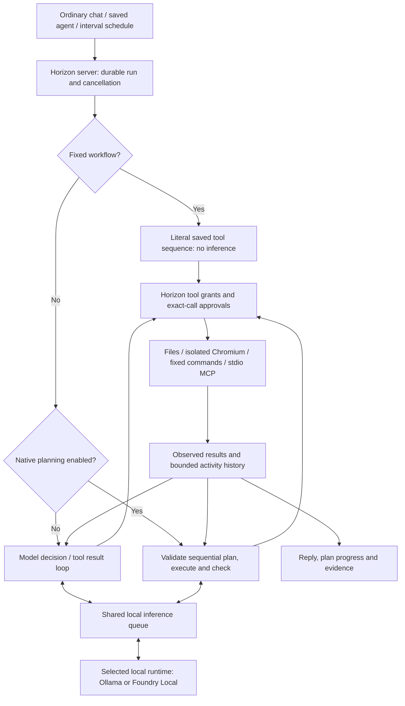
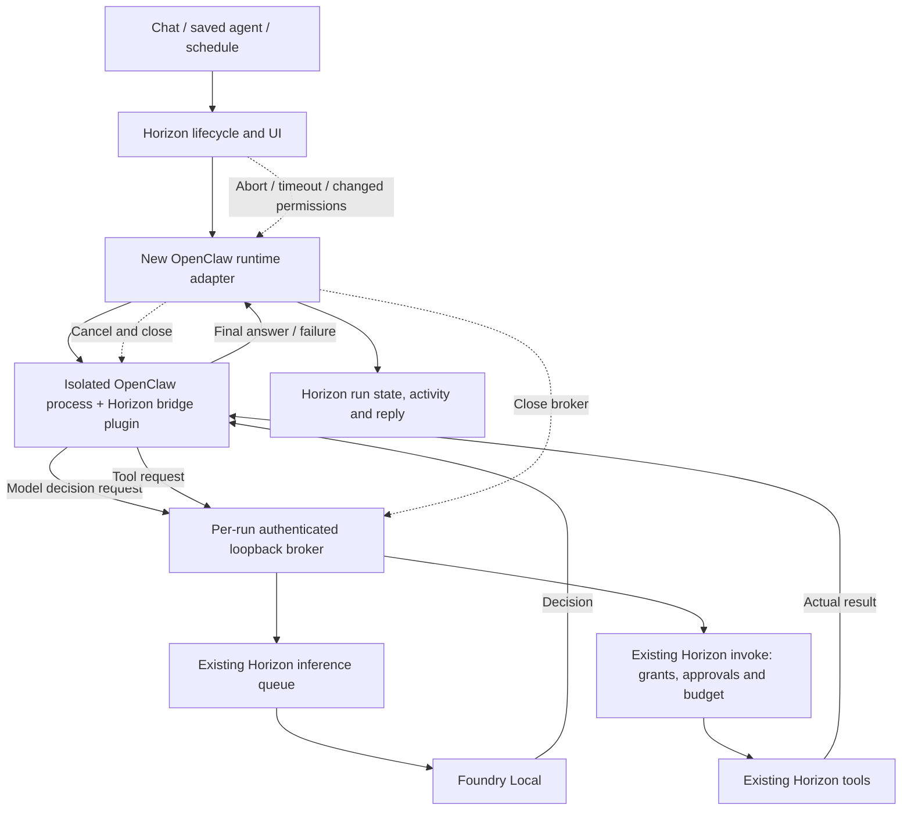

# Architecture and ownership

## Current supported path



The Horizon Native decision loop (`src/native-runtime.js`) can choose another
action after each tool result. It supports structured JSON actions and
OpenAI-compatible function tool calls through the selected local provider.
Before requesting approval or executing a model decision, it validates tool
availability, argument schemas and the entire native tool-call batch.
One format/schema correction is permitted per run; this does not consume the
tool budget or remove the final-answer decision. Unknown or unavailable tools,
exhausted budgets, inference errors and failed execution are not retried.
An uncertain side effect is never automatically replayed.

Runs retain a failure stage (inference, model response, validation, permissions,
budget, context or execution), and the UI displays it with the original error.
Model-loop completion records that independent outcome checks were not
configured; it is not evidence that the whole task was verified.

Experimental planned mode instead validates a straight-line plan, resolves
references to earlier structured results, executes it and evaluates checks.
It does not branch or replan after execution begins.

Fixed workflows bypass both the model loop and backend selection. Changing the
backend must not convert those workflows into model-driven tasks.

## Proposed OpenClaw path: not connected



Arrows are conceptual. The broker and injection seam exist; the adapter,
plugin and real-runtime lifecycle above still need implementation.

## Ownership

| Component | Owns | Must not assume |
|---|---|---|
| Horizon UI/server | Requests, schedules, saved agents, permissions, approvals, cancellation, durable history | An orchestrator's final text proves success |
| Native engine or OpenClaw | Coordinating local model decisions and authorised action requests | Access to tools not granted by Horizon |
| Foundry Local | Local inference with the selected model | Every model follows tool/JSON protocols reliably |
| Horizon tools | Real file, browser, fixed-command and MCP operations | Configured subprocesses are OS-sandboxed |
| Future adapter/plugin | Protocol translation and isolated runtime lifecycle | An upstream feature is automatically exposed or safe |

## Existing integration contracts

`src/agents.js` accepts an optional `orchestrate` callback in `AgentService`.
For model-driven runs with `settings.backend === "openclaw"`, it calls:

```js
await orchestrate({
  agent,
  prompt,
  settings,
  history,
  signal,
  invoke,
  onModel
});
```

The callback must return a final string. `invoke(tool, args)` goes through the
existing permission/approval path; the engine counts OpenClaw action requests
against the run's tool budget. `onModel()` records local model activity.
The run's signal carries cancellation and timeout.

**The server currently supplies no `orchestrate` callback.** Selecting OpenClaw
through hand-edited state fails explicitly; no UI backend selector is exposed.

`src/openclaw-broker.js` exports:

```js
const { baseUrl, token, close } = await createBroker({
  definitions, invoke, complete, signal,
  onModel, onFailure, maxModelCalls, timeoutMs
});
```

It binds a random port on `127.0.0.1`, issues a fresh per-run bearer token,
checks Host/origin metadata and exposes authenticated routes:

| Route | Purpose |
|---|---|
| `GET /tools` | Supplied, filtered tool definitions |
| `POST /tools/call` | Invoke an allowlisted Horizon tool |
| `GET /v1/models` | Synthetic local model identifier |
| `POST /v1/chat/completions` | Forward to the supplied local inference callback |

Read the implementation and tests for exact request shapes, alias handling,
limits and cancellation. The broker is not itself an OpenClaw plugin or a
production runtime adapter.

## Code map

| Files | Responsibility |
|---|---|
| `src/server.js` | Local API, selected-model inference callback, service lifecycle |
| `src/agents.js` | Settings, saved agents, queue, runs, approvals, schedules, native loop, backend seam |
| `src/agent-planner.js` | Sequential plans, result references, deterministic checks and bounded read retries |
| `src/agent-context.js` | Shared configured-resource and conversation-instruction formatting |
| `src/agent-tools.js` | File, browser and fixed-command tools |
| `src/agent-mcp.js` | Bounded stdio MCP transport and tool calls |
| `src/agent-owner.js`, `src/inference-queue.js` | Single runtime owner and serial inference |
| `src/openclaw-broker.js` | Inactive integration building block |
| `public/agents.js`, `public/chat-tools.js` | Settings, agents, activity, chat approvals and polling |
| `public/activity.js`, `public/app.css` | Event-driven activity and plan/evidence rendering |
| `public/speech.js`, `src/dictation.js` | Local speech playback and Foundry CLI dictation |
| `tools/index.template.html` | UI source; build generates `public/index.html` |
| `tools/setup-agent-runtime.js` | Provision supported browser dependencies, not OpenClaw |
| `tools/openclaw-runtime/package.json` | Unused isolated OpenClaw pin manifest, not an installed runtime |

## Limits worth preserving

Runs have time and tool-call budgets. History is bounded to 100 runs / 16 MB,
with up to 150 events per run and displayed tool results capped at 12,000
characters. Native model context is capped at 64,000 serialized JSON characters,
not tokens; the actual model's token limit also applies.

Schedules run only while the server and machine are available. Missed and
overlapping occurrences are skipped, not replayed. Startup marks unfinished
work interrupted rather than resuming it.

File roots constrain file tools, not arbitrary program effects. Configured
commands and MCP executables have their ambient OS permissions. Browser tools
use an ephemeral session, public HTTPS only, without personal sign-ins.
