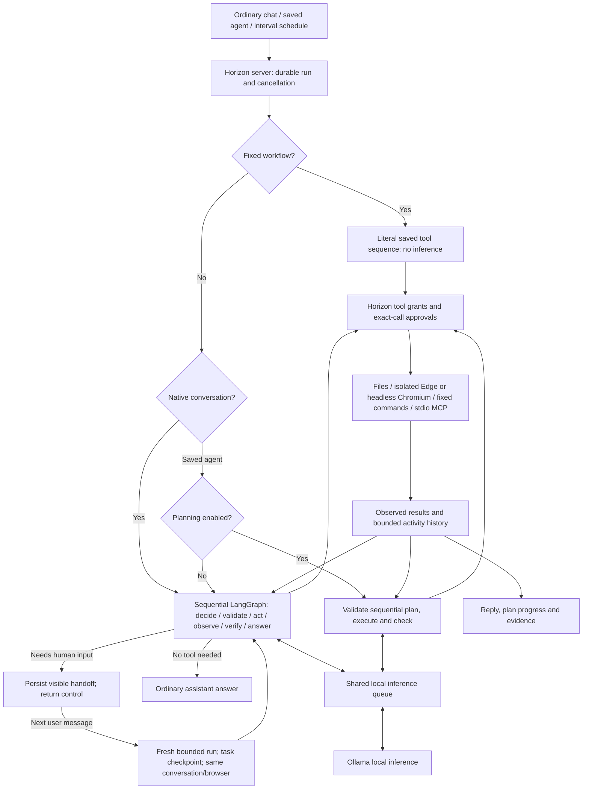

# Architecture and ownership

## Current supported path

Native conversations enter `src/native-runtime.js` directly with permitted tool
schemas. The same inference produces ordinary assistant text or native function
calls; no JSON classifier or mandatory plan runs first. Conversation protocol
normalizes to native without modifying persisted history/grants. Saved agents
retain their protocols and optional planner; fixed workflows remain literal.
Conversation approval preferences can only select allow/ask for reads within
granted folders and public browsing/search. Clicks/fills, writes, commands and
MCP remain exact-call approvals in conversations; model descriptions of intent
never influence this deterministic policy. Search constructs only a fixed
public HTTPS GET URL. Generic browser clicks/fills always ask, including saved
agents with unattended grants.

Browser state is keyed by a validated conversation ID for interactive runs:
visible, isolated Microsoft Edge contexts survive turn cleanup, track focus/manual navigation
and close explicitly, on manual disconnection, erase or shutdown. Saved tasks
use headless Chromium per-run contexts. Cancelling an in-flight browser action closes
its tab; other conversation tabs remain. All paths retain public-address and
IP-pinned proxy checks, blocked WebSockets/service workers and no downloads.
Manual selection tracking must disable Playwright's artificial per-page focus.
The narrowly guarded owning-session adapter is pinned to the existing
Playwright 1.55.1 dependency; unsupported implementations fail before browser
actions. Dependency upgrades require rerunning the actual visible-tab tests.

Consequential calls always need exact human approval, including saved/scheduled
agents with persisted unattended grants: writes, commands, MCP calls and
arbitrary browser clicks/fills cannot run unattended. The saved-agent automatic
allowlist is granted file reads, plus explicitly unattended public browser reads
or MCP tool listings. Conversation read preferences cannot expand any grant.

The Horizon Native LangGraph (`src/native-runtime.js`) can choose another
action after each tool result. It supports structured JSON actions and
OpenAI-compatible function tool calls through the selected local provider.
Before requesting approval or executing a model decision, it validates tool
availability, argument schemas and the entire native tool-call batch.
One shared format/schema/truncation/grounding correction is permitted per run; this does not consume the
tool budget or remove the final-answer decision. Unknown or unavailable tools,
exhausted budgets, inference errors and failed execution are not retried.
An uncertain side effect is never automatically replayed.

Interactive conversations also have a Horizon-owned `horizon_handoff` control
action. It is not an external tool, does not expand grants, and never starts a
background wait. When the model needs the user to act or answer before work can
continue, Horizon persists the handoff, shows **Waiting for you**, and returns
the composer immediately. The next message in that same browser-stored
conversation starts a fresh bounded run, marks the handoff as resumed and
receives a checkpoint capped at 8,000 characters containing the original
task intent and recent completed-tool results. The latest user message remains
controlling; permissions and approvals are revalidated and completed side
effects are not replayed automatically. The new run reuses only the existing
conversation ID and isolated browser binding; an open page is freshly observed
before the next model decision. No model or tool operation remains waiting in
the background.
Other chat history remains in browser storage, while bounded run events and the
checkpoint remain in Horizon's local runtime store. Restart still interrupts
unfinished work and closes ephemeral browser contexts; it never replays an
uncertain action or resumes a graph node.
For the viewport-only handoff, `browser_open` may omit its URL to open an
isolated `about:blank` page. After Horizon confirms the visible retained page,
the runtime records `awaiting_user` and returns a fixed ready message without
another model request or an automatic page read.

Runs retain a failure stage (inference, model response, validation, permissions,
budget, context or execution), and the UI displays it with the original error.
Non-browser completion records that independent outcome checks were not
configured. Browser answers pass only exact-text provenance verification,
not independent fact or intent verification.

`prepare` inspects the bound live browser identity/tab state without creating
a session. Retained pages are observed before inference, and navigation-only
actions force `observe` through the same AgentService invoke/approval gate.
The entire model batch is schema-validated before any effects. `verify`
resnapshots the current selected page and accepts only a model-selected exact
excerpt (2,000 characters maximum); an unsupported answer gets one bounded
correction, then fails. This deliberately sacrifices browser prose synthesis
for provenance. It does not establish a site's truth or distinguish a
relevant measurement from an unrelated sidebar. Missing facts must be reported
as missing, never filled from model memory.

Automatic observations and final verification count against maxSteps.
They do not expand grants or auto-approve requests. Execution/approval errors
are never automatically retried, and the graph has no side-effect retry policy.
The graph's recursion limit is an additional transition bound. Snapshot text
is bounded to 8,000 characters, recent history to 12 messages/16,000 characters,
all inference to 2,048 output tokens and overall context to 64,000 characters.
These bounds do not replace provider token limits or the AgentService timeout.

Dependencies are pinned to LangGraph 1.5.2 / Core 1.2.20 / zod 4.6.6.
Core requires Node >=20; launchers surface the upgrade from Node 18. Existing
HTTP provider adapters and the one local model remain unchanged.
No remote services or persistent LangGraph checkpoints are used. Graph state is
scoped to one invocation; AgentService keeps durable runs, events and a bounded
task-context checkpoint only for explicit human handoffs. Restart interrupts
unfinished work and discards graph and browser state, without resuming or
replaying effects. Enabled inherited
LangSmith/LangChain tracing or verbose flags fail closed before graph inputs;
global settings are never rewritten. Callbacks are empty.

Experimental planned mode instead validates a straight-line plan, resolves
references to earlier structured results, executes it and evaluates checks.
It does not branch or replan after execution begins.

Fixed workflows bypass model inference and retain all step results, bounded to
24,000 characters in the final run result.

## External orchestration: excluded

Horizon owns every orchestration decision and run lifecycle inside its Node.js
service. Ollama supplies local inference only; no external orchestrator,
backend callback or subprocess is part of the supported runtime. The supplied
OpenClaw archive is source-text reference only and must never be installed or
executed. Any retained broker or runtime-manifest files are inactive legacy
artifacts, not integration points.

## Ownership

| Component | Owns | Must not assume |
|---|---|---|
| Horizon UI/server | Requests, schedules, saved agents, permissions, approvals, cancellation, durable history | An orchestrator's final text proves success |
| Horizon Native engine | Coordinating local model decisions and authorised action requests | Access to tools not granted by Horizon |
| Ollama | Local inference with the selected model | Every model follows tool/JSON protocols reliably |
| Horizon tools | Real file, browser, fixed-command and MCP operations | Configured subprocesses are OS-sandboxed |
| Future adapter/plugin | Protocol translation and isolated runtime lifecycle | An upstream feature is automatically exposed or safe |

## Run lifecycle

`src/agents.js` owns the bounded queue, durable run state, approvals,
cancellation, timeout and cleanup. The only model-driven path enters
`src/native-runtime.js`, which validates every decision and routes tool calls
through Horizon's grant/approval gate. Old `backend: "openclaw"` settings are
normalized to `"native"` during load/save for compatibility; no external
orchestration callback is accepted or invoked.

## Code map

| Files | Responsibility |
|---|---|
| `src/server.js` | Local API, selected-model inference callback, service lifecycle |
| `src/agents.js` | Settings, saved agents, queue, runs, approvals, schedules and native graph entry |
| `src/native-runtime.js` | Actual sequential LangGraph, bounded decisions, observation and extractive provenance gate |
| `src/agent-planner.js` | Sequential plans, result references, deterministic checks and bounded read retries |
| `src/agent-context.js` | Shared configured-resource and conversation-instruction formatting |
| `src/agent-tools.js` | File, browser and fixed-command tools |
| `src/agent-mcp.js` | Bounded stdio MCP transport and tool calls |
| `src/agent-owner.js`, `src/inference-queue.js` | Single runtime owner and serial inference |
| `public/agents.js`, `public/chat-tools.js` | Settings, agents, activity, chat approvals and polling |
| `public/activity.js`, `public/app.css` | Event-driven activity and plan/evidence rendering |
| `public/speech.js` | Independent local browser/Windows read-aloud; no microphone recording |
| `tools/index.template.html` | UI source; build generates `public/index.html` |
| `tools/setup-agent-runtime.js` | Provision supported browser dependencies, not OpenClaw |
| `tools/openclaw-runtime/package.json` | Unused isolated OpenClaw pin manifest, not an installed runtime |

## Limits worth preserving

Runs have time and tool-call budgets. History is bounded to 100 runs / 16 MB,
with up to 150 events per run and displayed tool results capped at 12,000
characters. Native model context is capped at 64,000 serialized JSON characters,
not tokens; the actual model's token limit also applies.

Schedules run only while the server and machine are available. Missed and
overlapping occurrences are skipped, not replayed. Startup marks unfinished
work interrupted rather than resuming it.

File roots constrain file tools, not arbitrary program effects. Configured
commands and MCP executables have their ambient OS permissions. Browser tools
use an ephemeral session, public HTTPS only, without personal sign-ins.
